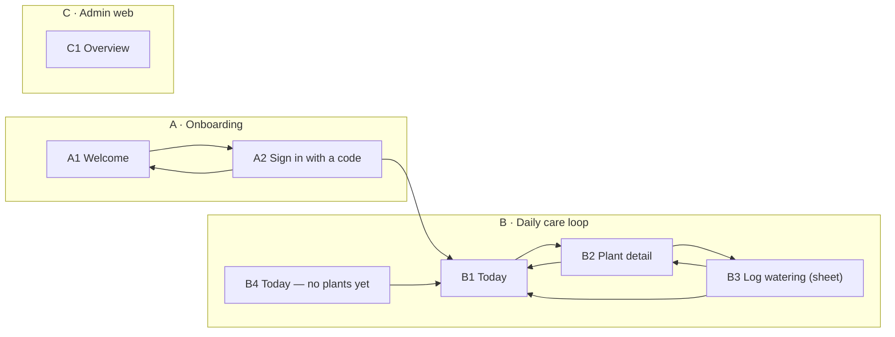

# PlantPal — screen spec

Generated by `uis spec` from `examples/plantpal/screens`. The HTML screens are the design source of truth; this file is the index for whoever builds the app.

- Design tokens: `kit/tokens.css` · components: `kit/components.css` + `COMPONENTS.md` · demo data & rules: `BRIEF.md`

## Navigation

## A · Onboarding

Device: phone

### A1 · Welcome

File: `screens/A1.html` · Shot: `shots/A1.png`

Goes to: A2 (Get started) · A2 (I already have an account)

Reached from: A2

1. First launch only. Returning signed-in users skip straight to B1.
2. **Get started** and **I already have an account** both open A2: sign-in and sign-up are the same e-mail code flow.

### A2 · Sign in with a code

File: `screens/A2.html` · Shot: `shots/A2.png`

Goes to: A1 (Back) · B1 (Continue)

Reached from: A1

1. Code: 6 digits, valid 10 min, single use; only the newest code works.
2. Continue enables at 6 digits; pasting a full code submits automatically. Success → B1 (or B4 for a new account).
3. Resend unlocks after 60 s. Wrong code: boxes turn red, "That code didn't work".

## B · Daily care loop

Device: phone

### B1 · Today

File: `screens/B1.html` · Shot: `shots/B1.png`

Goes to: B2 · B2 · B2 · B1 (3Today)

Reached from: A2, B1, B2, B3, B4

1. Home tab. "Needs water" = due today or overdue, most overdue first. Row → B2.
2. Overdue tags are red from 1 day late; due today is amber.
3. Streak card counts consecutive days with every due plant handled (BRIEF §5).
4. Tab badge = plants needing water today. No plants → B4.

### B2 · Plant detail

File: `screens/B2.html` · Shot: `shots/B2.png`

Goes to: B1 (Back) · B3 (Log watering)

Reached from: B1, B3

1. Full-length artboard; the photo stays behind the scrolling card.
2. **Log watering** → B3. **Snooze** moves the reminder 1 day (menu: 1 day / 2 days / skip this time).
3. The suggestion banner appears after 3+ logs show drift ≥ 15% from the schedule.

### B3 · Log watering (sheet)

File: `screens/B3.html` · Shot: `shots/B3.png`

Goes to: B2 (Close) · B1 (Save)

Reached from: B2

1. Opened from B2. Defaults to the last amount used for this plant.
2. **Save** logs the event, recomputes the next due date, returns to B1 with toast "Monty watered · next on Nov 3".
3. "When" allows back-dating up to 7 days (logged late).

### B4 · Today — no plants yet

File: `screens/B4.html` · Shot: `shots/B4.png`

Goes to: B1 (Today)

1. Empty state of B1 for a new account (shown right after A2).
2. **Take a photo** asks for camera permission, then identifies the species. **Pick from a list** opens search.

## C · Admin web

Device: desktop

### C1 · Overview

File: `screens/C1.html` · Shot: `shots/C1.png`

1. Range toggle (7/30/90 d) drives every number on the page. Export = CSV of the table + KPIs.
2. "Reminders handled" = due reminders followed by a log within 24 h.
3. Table rows open the user detail (not designed yet).
